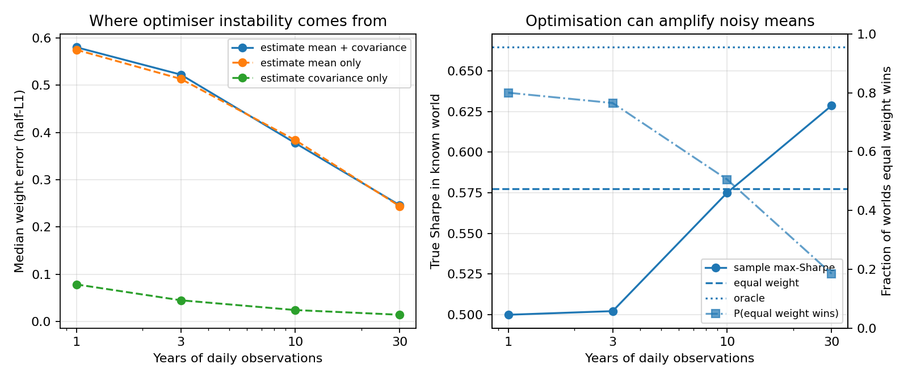
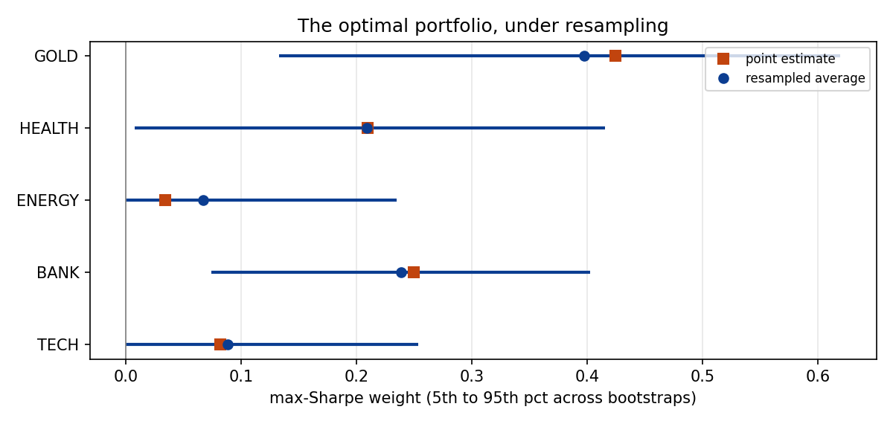
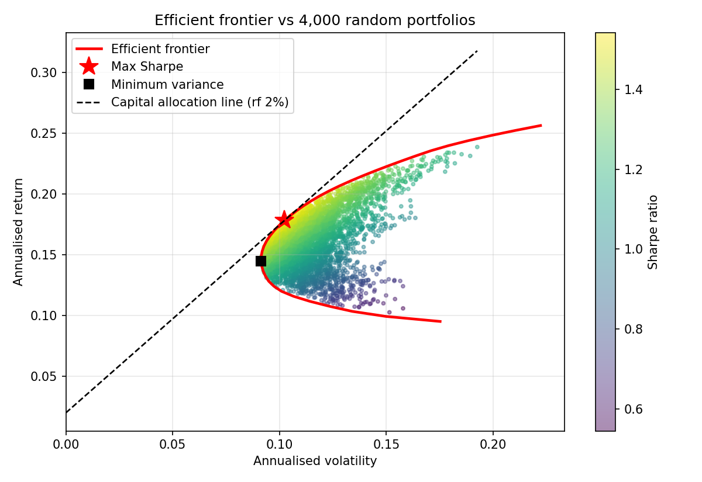
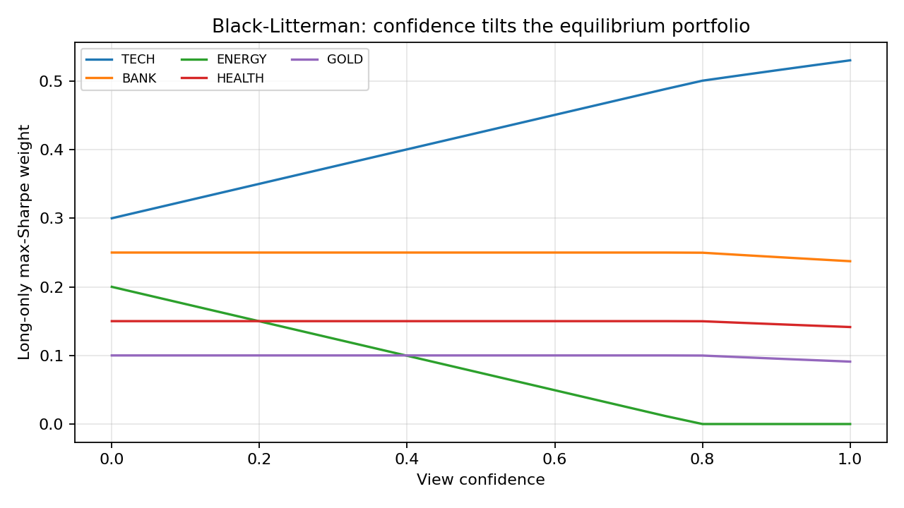

# Portfolio Optimisation Under Estimation Error

[](https://github.com/AhmadEblagh205/efficient-frontier-portfolio/actions/workflows/ci.yml)


Mean-variance optimisation is easy to draw and surprisingly hard to trust. This repository starts with the textbook Markowitz frontier, then turns the fragile part into the main experiment: **what happens when the expected returns and covariance matrix fed to the optimiser are only estimates?**

The project is an independent analytical rebuild of work I first explored in a UCL project (graded 92%). All headline results below use reproducible **synthetic / known-truth experiments**; they are not an investment track record.

## Main finding: the optimiser is mostly fighting noisy expected returns

`src/estimation_error.py` fixes a five-asset Gaussian return world with known annual means and covariance, simulates 200 paired histories, and recomputes the long-only maximum-Sharpe portfolio after 1, 3, 10 and 30 years of daily observations.

It separates three cases:

1. estimate both expected returns and covariance;
2. estimate expected returns while giving the optimiser the **true covariance**;
3. estimate covariance while giving it the **true expected returns**.



At **3 years**, the median half-L1 distance from the oracle weights is:

| Inputs with estimation error | Median weight error |
|---|---:|
| expected returns + covariance | **0.523** |
| expected returns only | **0.514** |
| covariance only | **0.045** |

The same pattern appears in true out-of-sample Sharpe evaluated under the known data-generating distribution: the median sample-optimised portfolio achieves **0.502**, while the covariance-only-error portfolio retains **0.663** versus an oracle **0.664**.

A deliberately boring **1/N portfolio** is therefore a useful sanity check. In this stated synthetic world it beats the sample maximum-Sharpe portfolio in **76.5% of the 3-year simulations**. With 30 years of data that falls to **18.5%** as the expected-return estimates become more informative.

The point is not that equal weight is universally optimal. It is that optimisation can magnify noisy inputs, and expected-return estimation is the dominant source of error in this benchmark.

## Bootstrap instability: one history, many “optimal” weights

`src/resampled.py` bootstraps the same return history and refits the maximum-Sharpe portfolio on each draw. The mean per-asset standard deviation of the weights is **0.107** in the default synthetic run. The resampled average is less concentrated than the single point estimate in that run, but this is used as a **stability diagnostic**, not as a universal claim that bootstrap-averaged weights are optimal.



## The textbook frontier is still here

`src/frontier.py` implements:

- annualised expected returns and covariance from log returns;
- 4,000 random long-only portfolios;
- the constrained efficient frontier;
- maximum-Sharpe and global-minimum-variance portfolios;
- the capital allocation line;
- an equal-weight diversification curve.



`src/simulate.py` adds a GBM fan chart for the fitted portfolio. It is a **model-based scenario illustration**, not a forecast.

## Two regularisation ideas — and what they actually fix

### Ledoit-Wolf covariance shrinkage

`src/shrinkage.py` compares the sample covariance with Ledoit-Wolf covariance shrinkage using a half-sample estimate / half-sample evaluation. In the default five-asset synthetic experiment the shrinkage intensity is small (**mean 0.025**) and the mean out-of-sample Sharpe difference is negligible (**0.736 sample covariance vs 0.733 Ledoit-Wolf**).

That negative result is useful: in this small-universe experiment, covariance shrinkage does not rescue the optimiser because covariance estimation is not the main failure mode. The known-truth benchmark above makes the expected-return problem explicit.

### Black-Litterman return shrinkage

`src/black_litterman.py` now keeps the accounting straight:

- reverse optimisation gives equilibrium **excess returns** `pi = delta Σ w_market`;
- the view is also expressed in excess-return space;
- the posterior is converted back to total expected returns before the ordinary Sharpe optimiser subtracts the risk-free rate.

This fixes a subtle but important bug in the original implementation, which subtracted the risk-free rate twice from equilibrium excess returns and therefore failed its own supposed zero-view sanity check.

The corrected implementation satisfies both limits:

- **0 confidence:** the posterior reproduces the equilibrium returns and the optimiser recovers the stated market weights `[0.30, 0.25, 0.20, 0.15, 0.10]` (within numerical tolerance);
- **100% confidence:** the posterior enforces the stated relative view, `TECH − ENERGY = 4 percentage points`.



This is a prior-and-view demonstration, not a claim that the chosen market weights or view are empirical truths.

## Usage

```bash
pip install -r requirements.txt

# textbook frontier on reproducible synthetic data
python src/frontier.py --synthetic

# estimation-error benchmark (200 known-truth worlds)
python src/estimation_error.py --worlds 200

# bootstrap allocation stability
python src/resampled.py --draws 300

# covariance-shrinkage experiment
python src/shrinkage.py --synthetic

# Black-Litterman prior/view path
python src/black_litterman.py

# scenario fan chart
python src/simulate.py --synthetic --horizon 252 --paths 2000
```

The frontier can also use a local price CSV or download ticker prices via `yfinance`. The committed analytical results and figures use synthetic data so the repository remains reproducible offline.

## Tests

```bash
pytest -q
```

The suite checks portfolio constraints, frontier target returns, Ledoit-Wolf covariance validity, bootstrap variability, Black-Litterman limit behaviour, and the known-truth estimation-error decomposition. CI runs the same test suite on push and pull request.

## What this project demonstrates

- constrained optimisation;
- covariance and expected-return estimation;
- optimizer sensitivity / estimation risk;
- paired Monte Carlo benchmarking against known truth;
- bootstrap stability analysis;
- Ledoit-Wolf covariance shrinkage;
- Black-Litterman reverse optimisation and view blending;
- scenario simulation;
- separating attractive in-sample geometry from defensible out-of-sample claims.

See [`docs/METHODOLOGY.md`](docs/METHODOLOGY.md) for the equations and experiment design.

## Licence

MIT, see [LICENSE](LICENSE).
